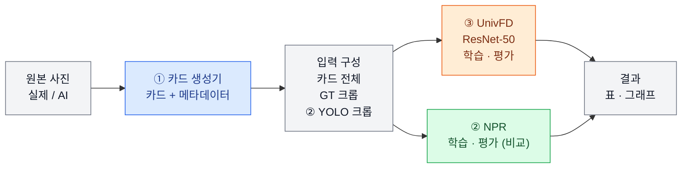
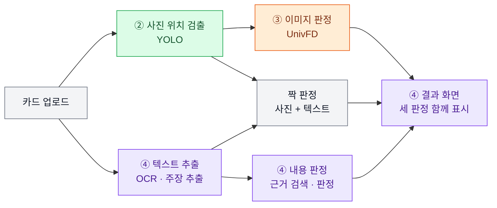
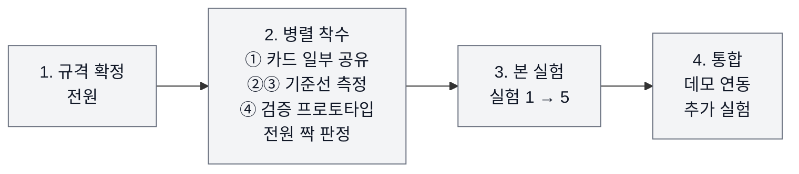

# 파이프라인 설계 문서 (초안)

> 카드뉴스 허위 정보 판별 및 AI 생성 이미지 탐지 · v0.2 (2026-11-23) 
> 인터페이스나 형식을 바꿀 때는 이 문서를 먼저 수정하고 팀에 공유

## 1. 개요

| 항목 | 내용 |
|---|---|
| 입력 | 카드 1장 (카드뉴스 이미지) |
| 출력 | 이미지 판정 (AI 생성 확률) · 짝 판정 (글이 사진과 맞는지) · 내용 판정 (사실 / 허위 / 판단 불가 + 근거) |
| 탐지 모델 | UnivFD (메인), ResNet-50 (베이스라인), NPR (비교) |
| 짝 판정 | 팀원 각자 방법으로 같은 짝 데이터에서 비교 |
| 데이터 | MiRAGeNews 사진·글, 글-사진 짝 데이터, 직접 생성한 카드 |
| 범위 밖 | 얼굴 합성 딥페이크 |

> **연구 질문** 사진이 카드뉴스로 편집될 때(축소·압축·텍스트 배치) AI 생성 이미지 탐지 성능이 얼마나 떨어지고, 사진 영역 크롭과 카드 데이터 추가 학습으로 얼마나 회복되는가? 
> **짝 판정 질문** 같은 짝 데이터에서 어떤 방법이 글-사진 불일치를 가장 잘 잡고, 안 맞는 글이 비슷할수록(easy → hard) 얼마나 어려워지는가?

| 용어 | 뜻 |
|---|---|
| 카드 | 카드뉴스 이미지 1장 (사진 + 제목·본문 텍스트·도형) |
| 카드 생성기 | 정답(실제/AI)을 아는 사진으로 실험용 카드를 자동 생성하는 프로그램 |
| GT 크롭 / YOLO 크롭 | 카드에서 사진만 잘라낸 것 (정답 좌표 기준 / YOLO 검출 기준) |
| AI 생성 확률 | 탐지 모델 출력값 (0~1), 클수록 AI 생성 가능성이 높음 |
| 짝 데이터 | 진짜 사진에 원래 글(맞음) 또는 다른 사진의 글(안 맞음)을 붙인 쌍 |
| easy / hard | 안 맞는 글을 무작위로 고른 세트 / 내용이 비슷한 글로 고른 세트 |
| 통합 시험 세트 | 진짜·AI 사진 × 맞는·안 맞는 글, 네 경우를 섞은 시험 문항 |

## 2. 시스템 구조

색상: 🟦 ① 데이터·카드 생성 · 🟩 ② 사진 위치 검출·비교 모델 · 🟧 ③ 메인 탐지 모델 · 🟪 ④ 내용 검증·통합 · ⬜ 전원

### 2.1 실험 파이프라인 (모델 학습·평가)

짝 판정은 짝 데이터(easy·hard)에서 팀원마다 각자 방법으로 판정하고, 결과를 `results/<이름>/`에 올려 비교한다.

### 2.2 시연 파이프라인 (카드 1장 판정)

- 실험에서 학습한 모델을 시연에서 사용. 짝 판정은 비교 결과가 가장 좋은 방법을 사용
- 실험용 카드는 정답이 필요해 직접 생성하고, 시연에는 실제 유통 카드를 사용
- 세 판정은 각각 수행해 함께 표시. 이미지 판정은 확률로 표시 (AI 생성 이미지 ≠ 허위 정보)

### 2.3 내용 판정 방식

| 구분 | 방식 |
|---|---|
| 트랙 1 | 근거 검색 후 LLM이 판정과 이유 생성 |
| 트랙 2 | 주장-근거 문장 쌍을 NLI 모델(KLUE-NLI 학습)로 분류 |
| 근거 출처 | KTV 카드뉴스 API, 정책브리핑 (정책·생활정보 카드뉴스 대상) |

> [!WARNING]
> 네이버 검색 API는 개정 약관상 AI 답변 생성 활용이 제한되어 사용하지 않음

## 3. 역할 및 인터페이스

| 구분 | 역할 | 주요 업무 | 출력 | 담당 |
|---|---|---|---|---|
| 🟦 ① | 데이터·카드 생성 | 데이터 준비·분할, 카드 생성기 | 카드, `meta.csv` | |
| 🟩 ② | 사진 위치 검출·비교 모델 | YOLO, NPR, 편집 강도 실험 | `detect_photos()` → 사진 위치 | |
| 🟧 ③ | 메인 탐지 모델 | UnivFD, ResNet-50, 공통 평가 코드 | `predict()` → AI 생성 확률 | |
| 🟪 ④ | 내용 검증·통합 | OCR·근거 검색·판정, 데모 앱 | `check_claims()` → 내용 판정 | |
| ⬜ 전원 | 짝 판정 | 각자 방법으로 짝 데이터 판정 | `results/<이름>/` | 전원 |

- 번호 순서는 사진 판정 흐름과 같음 (① 카드 생성 → ② 사진 위치 검출 → ③ AI 판정). ④는 텍스트 판정과 결과 화면
- 공통 규격: 이미지는 RGB, 좌표는 픽셀 `(x1, y1, x2, y2)`, 확률은 0~1
- 발표 담당 1명은 별도이며, 발표 관련 사항은 추후 결정

## 4. 데이터

| 데이터 | 용도 | 규모 |
|---|---|---|
| AI 사진 (MiRAGeNews) | AI 판정 학습·평가, 카드 원본 | 학습 10,000 · 검증 2,500 · 테스트 5 × 500 |
| 글-사진 짝 데이터 | 짝 판정 (easy·hard) | 진짜 사진 7,076장 → 세트당 14,152쌍 (테스트 1,660) |
| 통합 시험 세트 | 전체 시스템 평가 | 2,500문항 (네 경우 625씩) |
| B-Free 추가 데이터 (추후) | 미학습 생성기 테스트 | 실제 1,000 · FLUX 1,000 · SD3.5 1,000 |

받는 방법: `python data_preparation/prepare_all.py` (B-Free 제외, 자세한 내용은 `data_preparation/README.md`)

- BBC·CNN 테스트는 진짜(가로 JPEG, BBC 로고)와 AI(정사각 1024, DALL-E는 PNG)의 겉모습이 달라, 형식·크기를 맞춘 사진(가운데 256×256 자르기 + 같은 품질 JPEG) 결과도 함께 보고
- 실제/AI 사진의 형식·크기를 맞춘 뒤 카드 생성 (모델이 JPEG 여부·크기를 대신 학습하는 문제 방지)
- 원본 사진 기준으로 분할하고, 테스트용 템플릿은 학습에 사용하지 않음
- 카드마다 `meta.csv`에 정답·사진 위치·편집 강도 기록

> [!WARNING]
> 이미지 라이선스가 명시되어 있지 않아 사진은 저장소에 올리지 않음. 저장소에는 섞는 방법이 적힌 표와 스크립트만 두고, 사진은 각자 스크립트로 받음

## 5. 실험 계획

| 실험 | 비교 내용 | 결과 |
|---|---|---|
| 1. 입력 방식 | 입력 (카드 전체·GT 크롭·YOLO 크롭) × 학습 조건 (공개 가중치·원본·원본+카드) | 표 |
| 2. 편집 강도 | JPEG 품질, 축소 비율, 텍스트 가림 비율을 하나씩 변경 | 그래프 |
| 3. 일반화 | 미학습 생성기 (DALL-E 3, SDXL, FLUX, SD3.5)·미학습 디자인 | 표 |
| 4. 짝 판정 | 팀원 각자 방법 × easy·hard (테스트 1,660쌍씩) | 표 |
| 5. 통합 평가 (선택) | 통합 시험 세트로 이미지 판정 + 짝 판정을 함께 평가 | 표 |

- 지표: AUC, 정확도, FPR (실제 사진을 AI로, 또는 맞는 글을 안 맞음으로 잘못 판정한 비율)
- 추가 실험 (선택): GenD 방식 미세조정, GPT·Gemini 비교, 내용 판정 트랙 1·2 비교

> [!IMPORTANT]
> 기준값(임계값, 판정을 가르는 값)은 편집하지 않은 검증셋에서 한 번 정하고, 모든 조건에 똑같이 적용

## 6. 진행 순서

**결정 필요 사항**

- [ ] 담당자 배정
- [ ] 카드 문구(한글) 생성 방식, 템플릿 수, 카드 크기
- [ ] OCR 도구, 트랙 2 진행 여부
- [ ] 짝 판정 방법 (각자 선정 후 결과 비교)
- [ ] GPU 환경, 데모 도구 (Streamlit / Gradio)

## 7. 참고 자료

- 탐지 모델: [UnivFD](https://github.com/WisconsinAIVision/UniversalFakeDetect) · [NPR](https://github.com/chuangchuangtan/NPR-DeepfakeDetection) · [GenD](https://arxiv.org/abs/2508.06248)
- 데이터·실험 설계: [MiRAGeNews](https://huggingface.co/datasets/anson-huang/mirage-news) · [B-Free](https://grip-unina.github.io/B-Free) · [Fake or JPEG?](https://arxiv.org/abs/2403.17608)
- 짝 판정: [NewsCLIPpings](https://arxiv.org/abs/2104.05893) (무작위로 바꾼 짝은 너무 쉬움) · [MMFakeBench](https://arxiv.org/abs/2406.08772) (글 거짓·사진 가짜·글-사진 불일치 세 종류)
- 기타: [DocLayout-YOLO](https://github.com/opendatalab/DocLayout-YOLO) · [KLUE](https://arxiv.org/abs/2105.09680) · [KTV 카드뉴스 API](https://www.data.go.kr/data/15150410/openapi.do)
