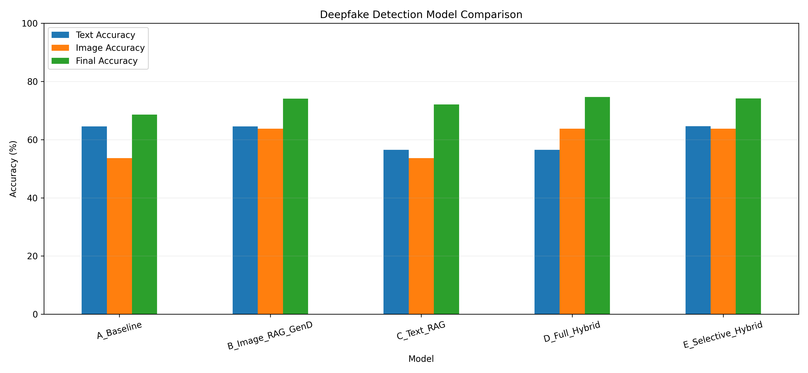

# Qwen 기반 뉴스 진위 판별 실험

## 1. 실험 목적

일반 Qwen 모델과 RAG 및 GenD를 적용한 모델의
텍스트·이미지 진위 판별 성능을 비교한다.

텍스트와 이미지가 모두 TRUE일 때만 최종 TRUE로 판정한다.

## 2. 실험 환경

- Google Colab / Tesla T4
- PyTorch 2.14.1
- Transformers 5.24.1
- Qwen3-VL-2B-Instruct (4-bit NF4)
- CLIP ViT-B/32
- GenD CLIP-L/14
- all-MiniLM-L6-v2
- FAISS

## 3. 데이터셋

MiRAGeNews 데이터셋을 사용한다.

팀 저장소의 data_preparation/prepare_all.py로 다운로드한다.

- Image Train: 8,958장
- Image Validation: 2,344장
- Image Test: 2,500장
- Text Train: 10,000개
- Text Validation: 2,500개
- 통합 Test: 5,000문항

이미지는 256x256 정규화 버전을 사용했다.

## 4. 실험 방법

| Model | Text | Image |
|---|---|---|
| A | Qwen | Qwen |
| B | Qwen | Image RAG + GenD |
| C | Text RAG + Qwen | Qwen |
| D | Text RAG + Qwen | Image RAG + GenD |
| E | Selective Text RAG + Qwen | Image RAG + GenD |

### Image RAG

- CLIP 기반 512차원 이미지 임베딩
- FAISS 코사인 유사도 검색
- Top-5 라벨 다수결
- 유사도 임계값: 0.64
- 라벨 일치율: 0.60
- 조건 미충족 시 GenD 사용
- GenD 임계값: 0.28

### Text RAG

- MiniLM 기반 384차원 텍스트 임베딩
- FAISS Top-5 검색
- 검색된 문장, 라벨, 유사도를 Qwen에 전달
- 선택적 RAG 유사도 임계값: 0.91

모든 임계값은 Validation 데이터에서 결정했다.

## 5. 실험 결과

| Model | Text Acc | Image Acc | Final Acc | F1 | Balanced Acc | FPR |
|---|---:|---:|---:|---:|---:|---:|
| A | 64.56% | 53.64% | 68.58% | 78.75% | 59.53% | 58.56% |
| B | 64.56% | 63.76% | 74.10% | 83.95% | 57.85% | 74.64% |
| C | 56.52% | 53.64% | 72.08% | 82.90% | 53.95% | 82.32% |
| D | 56.52% | 63.76% | 74.68% | 85.03% | 53.49% | 88.88% |
| E | 64.64% | 63.76% | 74.14% | 83.98% | 57.93% | 74.48% |

## 6. 결과 분석

- Image RAG + GenD 적용 시 이미지 정확도가
  53.64%에서 63.76%로 증가했다.
- Text RAG 적용 시 텍스트 정확도가
  64.56%에서 56.52%로 감소했다.
- 전체 적용 모델의 최종 정확도는
  68.58%에서 74.68%로 증가했다.
- 그러나 정상 콘텐츠에 대한 오탐률도 증가했다.
- 최종 FALSE 라벨의 비율이 75%이므로
  Accuracy만으로 성능 개선을 판단하기 어렵다.
- GenD 단독의 Validation AUC는 0.5075로 나타났다.

## 7. 한계

- Text RAG는 독립적인 사실 검증 근거가 아닌
  유사한 학습 문장과 라벨을 검색한다.
- GenD는 얼굴 딥페이크 탐지에 특화되어 있다.
- GenD의 개별 Test 성능은 측정하지 않았다.
- 데이터 분할 간 동일 사건 중복 여부는 추가 검증이 필요하다.
- 정규화 이미지에 대해서만 실험했다.
- 외부 웹 검색은 사용하지 않았다.

## 8. 파일 구성

- experiment.ipynb: Colab 실험 코드
- final_predictions.csv: 문항별 예측 결과
- final_summary.csv: 전체 성능
- case_summary.csv: 네 가지 진위 조합별 성능
- split_summary.csv: 데이터셋별 성능
- final_comparison.png: 비교 그래프

원본 데이터셋 및 모델 가중치는 저장소에 포함하지 않는다.
