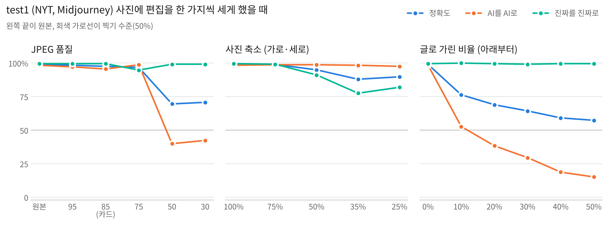

# 장성준 결과 — 판정 도구 3개 + 카드 편집 실험

## 한눈에 보기

| 판정 | 도구 | 원본 | 카드로 만들었을 때 |
|---|---|---|---|
| 사진이 AI인지 | UnivFD 방식 (CLIP + 선형 분류기) | 70.1% (학습 때 본 생성기 99.0%) | 카드 전체 54.4% · 잘라낸 사진 65.1% |
| 글이 사실인지 | Claude Haiku 5.5 + 웹 검색 | 83.1% | 83.5% (같은 카드를 원래 글로 판정하면 83.9%) |
| 글이 사진과 맞는지 | CLIP + 선형 분류기 | 87.8% (통합 시험) | 76.8% |
| **최종: 허위 카드뉴스를 잡은 비율** | 세 판정을 차례로 적용 | **88.5%** | **82.3%** |

**결론**

- 사진 판정은 카드로 만들면 크게 약해지고, 사진 부분만 잘라 넣으면 꽤 회복돼요.
- 편집을 한 가지씩 해 보면, 사진 판정을 가장 크게 망가뜨리는 건 사진 위에 글을 덮는 거예요. 아래 10%만 가려도 test1 정확도가 99.0%에서 76.4%로 떨어져요.
- 글-사진 짝 판정은 사진 위에 글을 덮은 카드에서 무너져요. CLIP이 사진 속 글자를 읽기 때문이에요.
- 가짜 글 판정은 카드로 만들어도 거의 그대로예요.
- 그래서 카드는 통째로 넣기보다 사진과 글을 나눠서 판정하는 게 좋아요. 다만 글이 사진을 덮은 카드는 나눠도 잘 안 돼요.

**읽는 법**

- 모두 테스트 데이터로 낸 결과예요. 따로 적지 않으면 %는 정확도이고, 판정 기준은 모두 확률 0.5예요.
- AUC는 기준값과 상관없이, 가짜 쪽(AI 사진·거짓 글·안 맞는 짝)에 진짜 쪽보다 높은 점수를 줄 확률이에요 (0.5 = 찍기, 1 = 완벽).
- 교차 시험·통합 시험·글-사진 짝 같은 시험 세트는 [data_preparation/README.md](../../data_preparation/README.md)에 설명이 있어요.
- 웹 검색은 "글이 사실인지"에서만 썼어요.

## 1. 판정 도구 (원본으로 시험)

### 사진이 AI인지 — UnivFD 방식

CLIP ViT-L/14는 그대로 두고, 그 위에 진짜/AI를 가르는 선형 분류기만 학습했어요. 학습 데이터는 MiRAGeNews train 10,000장(NYT 진짜 사진 5,000 + Midjourney AI 사진 5,000)이에요.

- 학습 때 본 생성기(test1, Midjourney)는 99.0% 맞혀요.
- 처음 보는 생성기는 잘 못 맞혀요. DALL-E 3는 53~56%, SDXL은 약 70~73%예요.
- BBC·CNN의 진짜 사진을 AI로 보는 경우가 많아요 (진짜 사진 정답률 44~60%).
- split별 표는 아래 "2. 카드 편집 실험"에 카드 결과와 함께 있어요.

### 글이 사실인지 — Claude Haiku 5.5 + 웹 검색

Claude Haiku 5.5가 글마다 웹 검색(최대 2번)으로 원래 기사를 찾고, 누가·무엇을·어디서·언제·숫자를 비교해요. 답은 사실·거짓·근거 부족 중 하나와 거짓일 확률(0~1)이에요. 글이 AI가 쓴 것처럼 보이는지는 판단에 쓰지 않게 했어요. AI가 썼다고 거짓은 아니라서예요.

시험 글은 교차·통합 시험에 나오는 글 1,660개(사실 830 + 거짓 830)예요.

| 출처 | 글 수 | 정확도 | AUC | 사실 글을 사실로 | 거짓 글을 거짓으로 |
|---|---|---|---|---|---|
| BBC | 582 | 83.0% | 0.919 | 90.7% | 75.3% |
| CNN | 578 | 85.6% | 0.951 | 94.1% | 77.2% |
| NYT | 500 | 80.2% | 0.879 | 86.4% | 74.0% |
| **전체** | **1,660** | **83.1%** | **0.918** | **90.6%** | **75.5%** |

- 사실 글은 잘 알아보지만, 거짓 글은 4개 중 1개를 놓쳐요.
- 판정의 28%가 "근거 부족"이었어요. "월요일에"처럼 날짜 없이 쓴 글이 많아 어느 기사인지 특정하기 어려웠어요. 이때도 거짓일 확률로 사실·거짓을 나눴어요.
- 비용은 $34.42(웹 검색 3,003번), 시간은 약 41분이었어요.

<details>
<summary>판정 분포 (사실 / 거짓 / 근거 부족)</summary>

| 정답 | 사실 | 거짓 | 근거 부족 |
|---|---|---|---|
| 사실 글 | 554 | 55 | 221 |
| 거짓 글 | 65 | 525 | 240 |

거짓 글 65개는 아예 "사실"로 판정했어요. 세부만 살짝 바꾼 글을 놓친 경우예요.

</details>

### 글이 사진과 맞는지 — CLIP + 선형 분류기

CLIP ViT-L/14로 사진과 글을 각각 특징으로 바꾸고, 둘이 맞는지 가르는 선형 분류기만 학습했어요.

| 시험 | 문항 | 정확도 | AUC | 맞는 짝을 맞다고 | 안 맞는 짝을 안 맞다고 |
|---|---|---|---|---|---|
| 글-사진 짝 easy | 1,660 | 92.0% | 0.989 | 84.9% | 99.0% |
| 글-사진 짝 hard | 1,660 | 83.0% | 0.910 | 84.9% | 81.0% |
| 통합 시험 | 2,500 | 87.8% | 0.982 | 76.6% | 99.0% |

- 비슷한 사건의 글을 붙인 hard는 easy보다 9%p 낮아요.
- 분류기를 학습해도 CLIP 유사도만 쓸 때와 AUC가 거의 같아요 (유사도만: easy 0.989, hard 0.911, 통합 0.981).

<details>
<summary>학습 설정</summary>

| 판정 | 학습 | 설정 고르기 (validation) |
|---|---|---|
| 사진이 AI인지 | MiRAGeNews train 10,000장 | 2,500장 → C = 0.01 (AUC 0.998, 정확도 98.0%) |
| 글이 사실인지 | 학습 없음 | 30개로 질문 문구 점검 |
| 글이 사진과 맞는지 | 글-사진 짝 train 19,988쌍 (easy + hard) | C = 0.001 (AUC 0.979) |

글-사진 짝 판정의 분류기 입력은 사진 특징과 글 특징을 칸마다 곱한 값 768개 + 코사인 유사도예요.

</details>

## 2. 카드 편집 실험

같은 시험 문항을 카드뉴스 이미지 6,250장으로 만들어 다시 판정했어요 (만드는 법: [cards/README.md](../../data_preparation/cards/README.md)). 카드에서 사진은 위치를 안다고 가정하고 잘라냈고, 글은 Tesseract로 읽어냈어요(OCR).

템플릿은 4가지예요: 사진 위·글 아래 / 제목 위·사진 가운데 / 글 많고 사진 작게 / 사진 위에 글 덮기

### 사진이 AI인지

원본 사진 2,500장과, 그 사진으로 만든 교차 시험 카드 5,000장으로 시험했어요. 괄호는 AUC예요.

| split | 출처 · 생성기 | 원본 | 카드 전체 | 잘라낸 사진 |
|---|---|---|---|---|
| test1_nyt_mj | NYT · Midjourney | 99.0% (0.999) | 56.4% (0.775) | 78.5% (0.943) |
| test2_bbc_dalle | BBC · DALL-E 3 | 55.6% (0.566) | 51.5% (0.563) | 54.7% (0.608) |
| test3_cnn_dalle | CNN · DALL-E 3 | 53.2% (0.519) | 54.1% (0.573) | 55.2% (0.569) |
| test4_bbc_sdxl | BBC · SDXL | 73.0% (0.799) | 54.2% (0.578) | 69.3% (0.730) |
| test5_cnn_sdxl | CNN · SDXL | 69.6% (0.815) | 55.6% (0.609) | 67.7% (0.755) |
| **전체** | | **70.1% (0.764)** | **54.4% (0.618)** | **65.1% (0.728)** |

- 카드 전체를 넣으면 AI 사진도 대부분 진짜라고 봐요. AI 사진을 AI로 맞힌 비율이 원본 78.6%에서 17.8%로 떨어져요.
- 사진 부분만 잘라 넣으면 꽤 회복돼요. test1에서 사진이 큰 두 템플릿(사진 위·글 아래, 제목 위·사진 가운데)은 93~97%예요.
- 사진 위에 글을 덮은 템플릿은 잘라도 그대로예요. 잘라낸 사진이 곧 카드 전체라서예요.
- 카드 전체를 넣으면 같은 사진이어도 카드 속 글에 따라 판정이 11.4% 바뀌어요. 글자가 판정에 끼어들어요.
- 처음 보는 생성기(DALL-E 3)는 원본부터 53~56%라, 카드의 영향은 test1에서 보는 게 정확해요.

<details>
<summary>자세히: 진짜·AI별, 템플릿별, 글만 다른 카드</summary>

**진짜·AI별로 맞힌 비율 (전체)**

| 입력 | 진짜를 진짜로 | AI를 AI로 | 문항 수 |
|---|---|---|---|
| 원본 | 61.6% | 78.6% | 2,500 |
| 카드 전체 | 90.9% | 17.8% | 5,000 |
| 잘라낸 사진 | 81.9% | 48.3% | 5,000 |

**템플릿별 (test1, 괄호: AUC)**

| 템플릿 | 카드 전체 | 잘라낸 사진 |
|---|---|---|
| 사진 위·글 아래 | 58.1% (0.746) | 96.8% (1.000) |
| 제목 위·사진 가운데 | 63.5% (0.824) | 92.9% (0.994) |
| 글 많고 사진 작게 | 52.0% (0.727) | 72.2% (0.981) |
| 사진 위에 글 덮기 | 52.0% (0.880) | 52.0% (0.880) |

글 많고 사진 작은 템플릿은 AUC가 0.981인데 정확도는 72.2%예요. 순서는 맞게 매기는데 점수가 전체적으로 낮아져서, 기준 0.5에서는 AI 사진을 진짜로 판정해요.

**글만 다른 카드끼리 판정이 바뀐 비율**

같은 사진에 사실 글 카드와 거짓 글 카드가 하나씩 있어요. 글에 흔들리지 않으면 0%예요.

| 입력 | 판정이 바뀐 비율 | 점수 차이 평균 | 쌍 |
|---|---|---|---|
| 카드 전체 | 11.4% | 0.110 | 2,500 |
| 잘라낸 사진 | 3.1% (사진 위에 글을 덮은 템플릿에서만) | 0.027 | 2,500 |

</details>

### 편집 강도: 무엇이 사진 판정을 망가뜨리나

카드에는 압축, 크기 바꾸기, 글 덮기가 한꺼번에 들어가서 원인을 따로 볼 수 없었어요. 그래서 원본 사진에 편집을 한 가지씩만 점점 세게 해서 다시 판정했어요 (계획서 실험 2). 분류기와 기준(0.5)은 그대로예요.

- **JPEG 품질:** 95 → 30으로 다시 저장 (카드는 85로 저장)
- **사진 축소:** 가로·세로를 75% → 25%로
- **글로 가린 비율:** 사진 아래쪽을 어두운 띠 + 흰 글씨(그 사건의 사실 글)로 10% → 50%



- **글 덮기가 가장 커요.** 10%만 가려도 정확도가 99.0%에서 76.4%로, 절반을 가리면 57.4%로 떨어져요. 진짜 사진은 그대로 맞히는데, AI 사진을 진짜로 보게 돼요 (AI를 AI로 98.4% → 15.2%).
- **JPEG는 카드 품질(85)까지는 거의 그대로예요** (97.6%). 50 이하로 세게 압축하면 AI 사진을 놓쳐요 (50에서 69.6%, AI를 AI로 40.0%).
- **사진 축소는 상대적으로 영향이 작아요.** 35%로 줄이면 88.0%이고, 이때는 반대로 진짜 사진을 AI로 보는 경우가 늘어요 (진짜를 진짜로 77.6%).
- 카드 결과와도 맞아요. 글이 없는 잘라낸 사진(사진 위·글 아래)은 96.8%로 JPEG 85일 때(97.6%)와 비슷하고, 글이 사진을 덮은 카드(52.0%)는 절반을 가렸을 때(57.4%)에 가까워요.
- 시험 사진은 test1과 SDXL(test4·5) 1,500장이에요. DALL-E 3는 원본부터 찍기 수준이라 뺐어요. SDXL은 세게 압축하면 오히려 정확도가 올라가요 (71.3% → 80.6%). 진짜 사진을 AI로 보던 게 줄어서예요.

<details>
<summary>자세히: 단계별 표 (test1, SDXL)</summary>

**test1 (NYT · Midjourney)**

| 편집 | 단계 | 정확도 (AUC) | 진짜를 진짜로 | AI를 AI로 |
|---|---|---|---|---|
| 원본 | | 99.0% (0.999) | 99.6% | 98.4% |
| JPEG 품질 | 95 | 98.4% (0.999) | 99.6% | 97.2% |
| JPEG 품질 | 85 | 97.6% (0.998) | 99.6% | 95.6% |
| JPEG 품질 | 75 | 96.8% (0.994) | 94.8% | 98.8% |
| JPEG 품질 | 50 | 69.6% (0.952) | 99.2% | 40.0% |
| JPEG 품질 | 30 | 70.8% (0.939) | 99.2% | 42.4% |
| 사진 축소 | 75% | 99.0% (0.999) | 99.2% | 98.8% |
| 사진 축소 | 50% | 95.0% (0.994) | 91.2% | 98.8% |
| 사진 축소 | 35% | 88.0% (0.983) | 77.6% | 98.4% |
| 사진 축소 | 25% | 89.8% (0.971) | 82.0% | 97.6% |
| 글로 가린 비율 | 10% | 76.4% (0.983) | 100.0% | 52.8% |
| 글로 가린 비율 | 20% | 69.0% (0.963) | 99.6% | 38.4% |
| 글로 가린 비율 | 30% | 64.4% (0.951) | 99.2% | 29.6% |
| 글로 가린 비율 | 40% | 59.2% (0.912) | 99.6% | 18.8% |
| 글로 가린 비율 | 50% | 57.4% (0.887) | 99.6% | 15.2% |

**SDXL (BBC · CNN)**

| 편집 | 단계 | 정확도 (AUC) | 진짜를 진짜로 | AI를 AI로 |
|---|---|---|---|---|
| 원본 | | 71.3% (0.802) | 51.8% | 90.8% |
| JPEG 품질 | 95 | 70.5% (0.818) | 50.0% | 91.0% |
| JPEG 품질 | 85 | 71.9% (0.827) | 52.6% | 91.2% |
| JPEG 품질 | 75 | 70.2% (0.787) | 49.4% | 91.0% |
| JPEG 품질 | 50 | 80.6% (0.893) | 80.4% | 80.8% |
| JPEG 품질 | 30 | 77.5% (0.870) | 87.4% | 67.6% |
| 사진 축소 | 75% | 71.4% (0.809) | 52.2% | 90.6% |
| 사진 축소 | 50% | 72.2% (0.812) | 54.6% | 89.8% |
| 사진 축소 | 35% | 70.1% (0.803) | 50.2% | 90.0% |
| 사진 축소 | 25% | 65.2% (0.770) | 43.0% | 87.4% |
| 글로 가린 비율 | 10% | 73.7% (0.825) | 80.2% | 67.2% |
| 글로 가린 비율 | 20% | 66.6% (0.756) | 80.4% | 52.8% |
| 글로 가린 비율 | 30% | 61.9% (0.713) | 80.8% | 43.0% |
| 글로 가린 비율 | 40% | 63.1% (0.714) | 84.2% | 42.0% |
| 글로 가린 비율 | 50% | 62.0% (0.714) | 85.0% | 39.0% |

</details>

### 카드 글자 읽기 (OCR)

글이 길면 카드에 다 안 들어가서 뒷부분이 잘려요. 그래서 읽기 정확도는 카드에 보이는 글과 비교했어요.

| 템플릿 | 글이 잘린 카드 | 보이는 글을 그대로 읽은 카드 | 읽기 오류율 (글자 기준) |
|---|---|---|---|
| 사진 위·글 아래 | 26.9% | 95.0% | 0.05% |
| 제목 위·사진 가운데 | 35.7% | 94.9% | 0.05% |
| 글 많고 사진 작게 | 2.4% | 98.1% | 0.02% |
| 사진 위에 글 덮기 | 30.6% | 92.0% | 0.25% |
| **전체** | **23.9%** | **95.0%** | **0.09%** |

- 원래 글과 똑같이 읽힌 카드는 73.6%예요. 나머지 1,653장은 글이 잘렸거나(1,462장) 조금 잘못 읽혔어요(191장).
- 잘못 읽은 경우는 대부분 "at a" → "ata"처럼 작은 실수예요. 사진 위에 글을 덮은 템플릿은 첫 줄을 통째로 놓치기도 해요.

### 글이 사진과 맞는지

통합 시험 카드 2,500장을 잘라낸 사진 + 읽어낸 글로 판정했어요.

| 템플릿 | 문항 | 정확도 | AUC | 맞는 짝을 맞다고 | 안 맞는 짝을 안 맞다고 |
|---|---|---|---|---|---|
| 사진 위·글 아래 | 628 | 87.4% | 0.982 | 75.3% | 99.7% |
| 제목 위·사진 가운데 | 626 | 86.1% | 0.978 | 73.6% | 98.7% |
| 글 많고 사진 작게 | 622 | 83.3% | 0.979 | 67.2% | 99.0% |
| 사진 위에 글 덮기 | 624 | 50.2% | 0.705 | 100.0% | 0.3% |
| **전체** | **2,500** | **76.8%** | **0.811** | **79.0%** | **74.5%** |

- 사진과 글이 따로 있는 템플릿은 원본(87.8%)과 비슷해요.
- 사진 위에 글을 덮은 템플릿은 잘라낸 사진 안에 글이 그대로 있어요. CLIP이 그 글자를 읽고, 글이 사진과 안 맞아도 거의 다 "맞다"고 판정해요.

### 글이 사실인지

원래 글과 똑같이 읽힌 카드는 원래 판정을 그대로 쓰고, 달라진 글 805개만 다시 판정했어요 ($16.63, 약 20분). 아래는 카드 6,250장 기준이라 글 1,660개 기준(83.1%)과 조금 달라요.

| 템플릿 | 카드 수 | 원래 글 | 카드에서 읽어낸 글 | 차이 |
|---|---|---|---|---|
| 사진 위·글 아래 | 1,568 | 83.9% | 84.1% | +0.3%p |
| 제목 위·사진 가운데 | 1,564 | 84.9% | 84.1% | -0.8%p |
| 글 많고 사진 작게 | 1,558 | 82.1% | 82.1% | +0.0%p |
| 사진 위에 글 덮기 | 1,560 | 84.7% | 83.8% | -0.9%p |
| **전체** | **6,250** | **83.9%** | **83.5%** | **-0.4%p** |

- 글이 잘려도 -1.3%p, 조금 잘못 읽혀도 -1.6%p로 거의 그대로예요.
- 잘린 글은 대부분 길이가 긴 사실 글이에요 (잘린 카드 1,462장 중 1,120장). 앞부분만으로도 원래 기사를 찾을 수 있었어요.
- 같은 글을 다시 판정해도 ±1%p 정도는 흔들릴 수 있어서, 이 정도 차이는 사실상 없다고 봐요.

<details>
<summary>읽힌 상태별</summary>

| 읽힌 상태 | 카드 수 | 원래 글 | 카드에서 읽어낸 글 | 차이 |
|---|---|---|---|---|
| 같게 읽힘 | 4,597 | 81.9% | 81.9% | +0.0%p |
| 잘림 | 1,462 | 90.4% | 89.1% | -1.3%p |
| 읽기 실수 | 191 | 82.2% | 80.6% | -1.6%p |

</details>

## 3. 세 판정을 합친 최종 판정

카드 한 장을 아래 순서로 판정해요. AI 사진이어도 내용이 사실이면 허위로 치지 않고 "주의"로만 표시해요.

| 순서 | 조건 | 최종 판정 |
|---|---|---|
| 1 | 글이 사실이 아님 | 허위 (글이 거짓) |
| 2 | 글은 사실이지만 사진과 안 맞음 | 허위 (글-사진 불일치) |
| 3 | 내용은 괜찮고 사진만 AI | 주의 (AI 사진) |
| 4 | 셋 다 아님 | 정상 |

같은 카드 6,250장을 원본(사진 + 원래 글)과 카드(잘라낸 사진 + 읽어낸 글)로 판정했어요.

| 지표 | 원본 | 카드 |
|---|---|---|
| 허위를 잡은 비율 (진짜 허위 중) | 88.5% | 82.3% |
| 허위 판정이 맞은 비율 (허위라고 한 것 중) | 79.6% | 80.5% |
| 허위인지 아닌지 맞은 비율 | 79.5% | 77.4% |
| 4가지 판정이 정확히 맞은 비율 | 65.5% | 62.9% |

| 정답 | 카드 수 | 원본 | 카드 |
|---|---|---|---|
| 허위 (글이 거짓) | 3,125 | 76.4% | 75.3% |
| 허위 (글-사진 불일치) | 625 | 90.4% | 68.5% |
| 주의 (AI 사진) | 1,250 | 44.6% | 27.8% |
| 정상 | 1,250 | 46.9% | 64.0% |

- 허위 카드뉴스는 원본에서 10장 중 9장 가까이, 카드에서 8장 넘게 잡아요. 사진 위에 글을 덮은 카드에서만 크게 떨어져요 (64.0%).
- 4가지를 정확히 나누는 건 어려워요. 가장 약한 건 AI 사진 판정이에요.
- 카드에서 "정상"이 더 잘 맞는 건, 잘라낸 사진을 AI로 덜 보기 때문이에요. 그만큼 AI 사진도 놓쳐요.

<details>
<summary>템플릿별 (카드)</summary>

| 템플릿 | 4가지 판정 정확도 | 허위를 잡은 비율 |
|---|---|---|
| 사진 위·글 아래 | 65.9% | 88.3% |
| 제목 위·사진 가운데 | 65.2% | 88.4% |
| 글 많고 사진 작게 | 62.2% | 88.4% |
| 사진 위에 글 덮기 | 58.3% | 64.0% |

</details>

## 4. 한계

- 카드 안에서 사진이 있는 위치는 안다고 가정했어요. 실제 카드뉴스에서는 자동으로 찾아야 해요.
- 카드 템플릿은 4가지뿐이고, 글은 모두 영어 뉴스 사진 설명이에요.
- 편집 강도 실험은 사진 판정만, 글 덮기도 한 가지 방식(어두운 띠 + 흰 글씨)으로만 했어요.
- 가짜 글 판정은 Claude Haiku 5.5 기준이에요. 더 강한 모델이면 점수가 달라질 수 있어요.
- "AI 사진 + 사실 글" 카드는 같은 사건이라 정답을 "맞음"으로 정했어요. 하지만 AI 사진은 지어낸 글을 보고 그린 거라 세부가 다를 수 있어요. 그래서 최종 판정(원본)에서 이 카드의 39%가 "글-사진 불일치"로 나왔는데, 꼭 틀렸다고 보기는 어려워요.

## 5. 팀원 결과와 비교하기

결과 파일에는 id와 점수만 있어요 (글·사진은 라이선스 때문에 올리지 않았어요). 아래 열로 문항을 이으면 같은 문항끼리 비교할 수 있어요.

| 판정 | 결과 파일 | 문항을 잇는 열 |
|---|---|---|
| 사진이 AI인지 | `scores.csv` | `input`(original·card·crop) + `id`(원본은 image_id, 카드는 card_id) |
| 글이 사실인지 | `factcheck_scores.csv` | `text_id`(띄어쓰기를 정리한 글의 sha1 앞 12자리, `factcheck.py`의 `text_id`) |
| 글이 사실인지 (카드) | `factcheck_card_scores.csv` | `card_id` |
| 글이 사진과 맞는지 | `match_scores.csv` | `set` + `id`(글-사진 짝은 pair_id, 통합 시험은 item_id, 카드는 card_id) |
| 최종 판정 | `final_scores.csv` | `card_id` |
| 편집 강도 실험 | `edit_strength_scores.csv` | `edit` + `level` + `id`(image_id) |

사진 판정은 같은 형식(`input,id,score`)으로 점수 파일을 만들면 위와 같은 표가 나와요.

```bash
python results/장성준/score_cards.py 점수파일.csv
```

편집 강도 실험을 팀원 도구로 하려면, `edit_strength.py`의 `apply_edit()`로 같은 편집을 한 사진을 만들면 돼요.

## 6. 다시 돌리기

저장소 맨 위 폴더에서 차례로 실행해요. 결과는 각자 컴퓨터의 `data/`에 생겨요.

```bash
pip install onnxruntime huggingface_hub tokenizers scikit-learn pillow numpy pyarrow rapidfuzz matplotlib anthropic
pip install openvino                            # 선택: 인텔 CPU에서 몇 배 빨라짐

python data_preparation/prepare_all.py          # 데이터 받기
python data_preparation/cards/make_cards.py     # 카드 6,250장 만들기
python results/장성준/univfd.py                  # 사진이 AI인지 (CPU 2코어로 약 1시간)
python results/장성준/edit_strength.py           # 편집 강도 실험 (CPU 2코어로 약 1시간)
python results/장성준/ocr_cards.py               # 카드 글자 읽기 (약 9분, Tesseract 필요)
python results/장성준/match_clip.py              # 글이 사진과 맞는지
python results/장성준/factcheck.py               # 글이 사실인지 (API 키 필요, 약 $35·41분)
python results/장성준/factcheck.py --set cards   # 카드에서 읽어낸 글 (약 $17·20분)
python results/장성준/final_verdict.py           # 최종 판정
```

- **API 키:** [platform.claude.com](https://platform.claude.com)의 API Keys에서 만들고, 실행할 창의 `ANTHROPIC_API_KEY` 환경 변수에 넣어요 (Mac·Linux `export ANTHROPIC_API_KEY="..."`, PowerShell `$env:ANTHROPIC_API_KEY="..."`). 키는 저장소나 채팅에 올리지 않아요.
- **비용:** 처음엔 `factcheck.py --set validation --limit 30`으로 30개(1달러 미만)만 돌려 보세요. 전체 실행은 시작 전에 예상 비용을 묻고, 쓴 금액이 `--budget`(기본 $45)에 닿으면 멈춰요.
- `univfd.py`, `edit_strength.py`, `factcheck.py`는 중간에 멈춰도 다시 실행하면 이어서 해요.
- 컴퓨터와 실행마다 숫자가 조금 다를 수 있어요. 가짜 글 판정은 같은 글도 매번 조금씩 달라요.

## 7. 파일

| 파일 | 내용 |
|---|---|
| `univfd.py` | 사진이 AI인지 판정 |
| `factcheck.py` | 글이 사실인지 판정 |
| `match_clip.py` | 글이 사진과 맞는지 판정 |
| `ocr_cards.py` | 카드 글자 읽기 |
| `final_verdict.py` | 세 판정을 합친 최종 판정 |
| `edit_strength.py` | 편집 강도 실험 (편집을 한 가지씩 세게 해서 사진 판정) |
| `score_cards.py` | 사진 판정 채점 (어떤 판정 도구든 점수 파일만 있으면) |
| `scores.csv` | 사진 판정 점수 (원본·카드·잘라낸 사진마다 AI일 확률) |
| `factcheck_scores.csv` | 글 판정 결과 (글마다 판정, 거짓일 확률) |
| `factcheck_card_scores.csv` | 카드 글 판정 결과 (카드마다 원래 글·읽어낸 글의 거짓일 확률) |
| `match_scores.csv` | 글-사진 짝 판정 점수 (문항마다 안 맞을 확률, CLIP 유사도) |
| `final_scores.csv` | 최종 판정 결과 (카드마다 정답, 원본·카드 판정, 세 확률) |
| `edit_strength_scores.csv` | 편집 강도 실험 점수 (편집·단계·사진마다 AI일 확률) |
| `edit_strength.png` | 편집 강도 실험 그래프 (test1) |
| `test_*.py` | 코드 점검 (`python -m pytest -q results`) |
